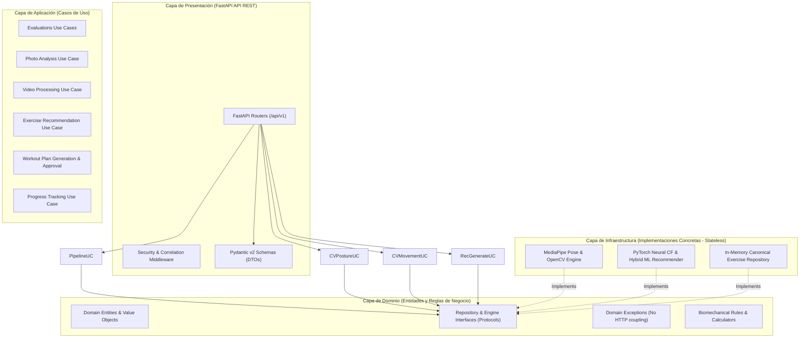

# Documento de Arquitectura de Software — Microservicio IA para ERP Gimnasio

Este documento describe la arquitectura integral del microservicio de Inteligencia Artificial desarrollado para integrarse con el ERP de Gimnasio.

---

## 1. Principios de Diseño y Estilo Arquitectónico

El sistema se rige bajo **Clean Architecture** (Arquitectura Limpia) y principios **SOLID**, garantizando:
- **Independencia de Frameworks:** El núcleo de negocio (Dominio) no depende de FastAPI, SQLAlchemy ni librerías de Visión por Computadora (OpenCV, MediaPipe).
- **Testabilidad:** Cada caso de uso y algoritmo puede probarse de forma aislada sin levantar base de datos ni servicios externos.
- **Inversión de Dependencias (DIP):** Las capas externas (Infraestructura, Presentación) dependen de interfaces y protocolos definidos en el interior (Dominio y Aplicación).
- **Tolerancia Cero a Resultados Simulados:** Prohibición estricta de simular inferencia de IA o datos de salud.

---

## 2. Diagrama de Arquitectura Modular



---

## 3. Estructura de Directorios del Proyecto

```text
gym-ai-service/
├── app/
│   ├── main.py                     # Punto de entrada FastAPI y configuración de ciclo de vida
│   ├── core/                       # Configuración (Pydantic Settings), seguridad, logging
│   │   ├── config.py
│   │   ├── security.py
│   │   └── logging.py
│   ├── api/
│   │   └── v1/                     # Routers versionados por contexto
│   │       ├── api_router.py
│   │       ├── endpoints/
│   │       │   ├── evaluations.py
│   │       │   ├── images.py
│   │       │   ├── videos.py
│   │       │   ├── recommendations.py
│   │       │   ├── workout_plans.py
│   │       │   ├── progress.py
│   │       │   └── health.py
│   ├── domain/                     # Núcleo puro (Entidades, Interfaces, Excepciones)
│   │   ├── entities/
│   │   ├── exceptions/
│   │   └── interfaces/
│   ├── modules/                    # Lógica de aplicación organizada por capacidades
│   │   ├── evaluations/
│   │   ├── image_analysis/
│   │   ├── video_analysis/
│   │   ├── pose_estimation/
│   │   ├── recommendations/
│   │   ├── workout_plans/
│   │   └── progress_tracking/
│   ├── infrastructure/             # Implementaciones concretas
│   │   ├── database/               # Sesión async SQLAlchemy, Base, repositorios
│   │   ├── models/                 # Modelos ORM relacionales
│   │   ├── cv/                     # MediaPipe Pose y utilidades OpenCV
│   │   └── ml/                     # PyTorch NCF y motores de recomendación
│   └── shared/                     # Tipos compartidos, constantes y utilidades
├── ml/
│   ├── datasets/                   # Dataset de ejercicios (exercises_clean.csv)
│   ├── inference/                  # Scripts aislados de inferencia
│   └── training/                   # Scripts de entrenamiento de modelos
├── migrations/                     # Entorno de Alembic
├── tests/
│   ├── unit/                       # Pruebas unitarias de dominio y cálculo geométrico
│   ├── integration/                # Pruebas de base de datos y repositorios
│   ├── api/                        # Pruebas de endpoints FastAPI con TestClient / httpx
│   └── ml/                         # Pruebas de modelos de visión y recomendador
├── docs/                           # Documentación técnica obligatoria
├── references/                     # Repositorios externos de referencia
├── Dockerfile                      # Imagen multi-stage optimizada para Python 3.12
├── compose.yaml                    # Orquestación con PostgreSQL y servicio FastAPI
├── pyproject.toml                  # Configuración de dependencias, Ruff, mypy y Pytest
└── README.md                       # Guía de inicio rápido y especificaciones
```

---

## 4. Contratos entre Módulos y Flujo de Datos

1. **Análisis de Fotografías (`image_analysis`):**
   - Recibe la imagen y el ángulo de toma (`FRONTAL`, `LATERAL`, `POSTERIOR`).
   - Retorna coordenadas de landmarks validadas, ángulos articulares principales (hombro-cadera, cadera-rodilla-tobillo) e índice de simetría con factor de confianza.
   - En caso de baja visibilidad, emite un estado de error controlado sin inferir datos corporales no observables.

2. **Análisis de Videos (`video_analysis`):**
   - Procesa videos de sentadillas o flexiones cuadro a cuadro.
   - Extrae la serie temporal de ángulos articulares clave.
   - Determina fases del ejercicio (Ej: `DESCENSO`, `INFLEXION`, `ASCENSO`) y cuenta repeticiones válidas, midiendo profundidad y postura del torso.

3. **Motor Híbrido de Recomendación (`recommendations`):**
   - Toma el perfil físico del cliente, restricciones médicas declaradas y los hallazgos de simetría/movilidad de las evaluaciones visuales.
   - Aplica filtrado estricto de seguridad $\rightarrow$ Filtrado por contenido (Cold Start) $\rightarrow$ Ranking Neural CF (NCF PyTorch).

4. **Generador de Rutinas y Human-in-the-Loop (`workout_plans`):**
   - Estructura los ejercicios recomendados en una rutina semanal completa (días, series, repeticiones, descansos).
   - Registra la rutina en estado inmutable `PENDIENTE_APROBACION`.
   - Proporciona endpoint seguro para que el entrenador del ERP revise, modifique y apruebe (`APROBADA`) la propuesta antes de que esté disponible para el cliente.
