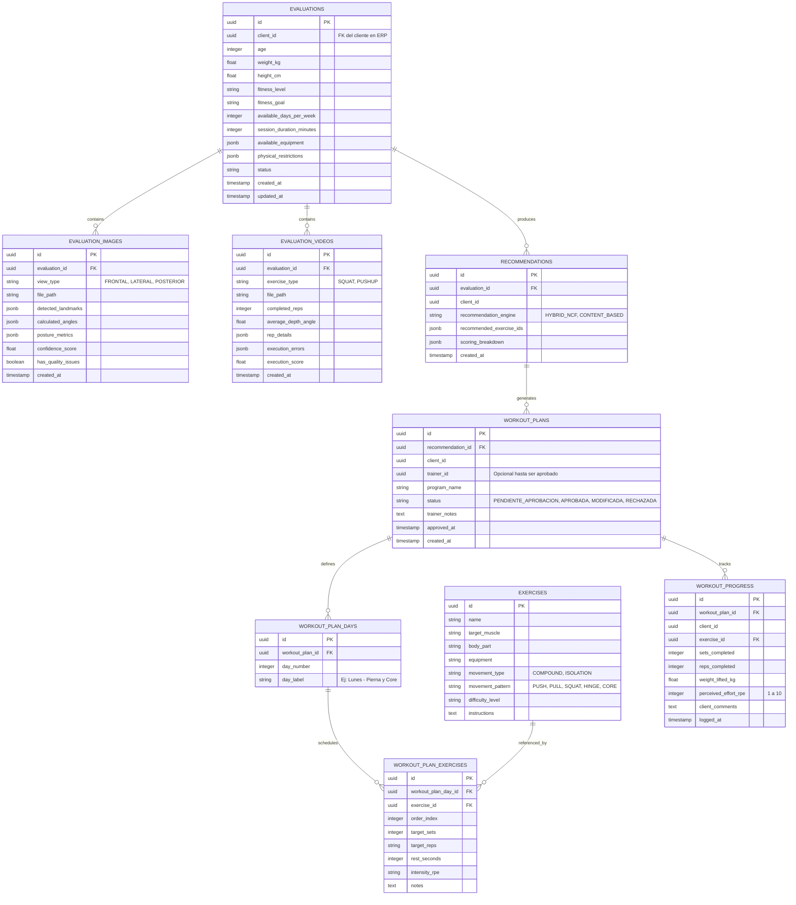

# Documento de Datos, Entidades y Modo Stateless

> [!IMPORTANT]
> **Modo Operativo del Microservicio: Stateless (Cero Persistencia en BD - ADR-005)**  
> Conforme al requerimiento del ERP de Gimnasio, este microservicio opera como **motor puro de inferencia y cómputo biomecánico en memoria**. No persiste datos personales, biométricos ni rutinas en bases de datos externas ni retiene archivos en disco. El ERP es el único custodio y repositorio persistente de los datos de clientes.  
> Los esquemas relacionales descritos abajo corresponden a la estructura de dominio y a los repositorios desacoplados mediante DIP.

---

## 1. Diagrama Entidad-Relación (Mermaid)

---

## 2. Índices y Reglas de Integridad

1. **Evaluations:**
   - Índice sobre `client_id` para acelerar consultas históricas del ERP: `CREATE INDEX idx_evaluations_client ON evaluations(client_id);`
   - Índice sobre `created_at` para ordenar evoluciones temporales.

2. **Workout Plans:**
   - Índice sobre `(client_id, status)` para consultar rápidamente la rutina vigente y planes pendientes de revisión por entrenadores.

3. **Exercises:**
   - Búsqueda por `body_part`, `target_muscle`, `equipment` y `difficulty_level`.
   - Carga inicial provista por el dataset enriquecido canónico `exercises_clean.csv`.
