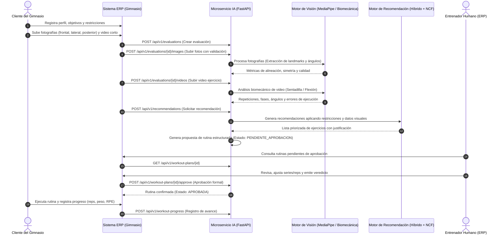

# Documento de Flujo Funcional del Microservicio de IA

Este documento describe la secuencia completa de interacción entre el cliente del gimnasio, el sistema ERP, el microservicio de IA y el entrenador responsable.

---

## 1. Diagrama de Flujo de Datos y Decisión de IA

---

## 2. Descripción de las Fases del Flujo

### 2.1 Fase de Ingreso y Evaluación Física
1. El ERP transmite el `client_id` (UUID) y los datos declarados: edad, peso, altura, nivel de condición física, objetivo principal y posibles restricciones articulares o patologías reportadas.
2. El microservicio registra la evaluación en estado `BORRADOR` / `PROCESANDO`.

### 2.2 Fase de Procesamiento Visual
1. **Fotografías:**
   - Se validan formatos (JPEG, PNG) y tamaño máximo.
   - MediaPipe Pose identifica 33 puntos de referencia tridimensionales.
   - Se calcula el plano de hombros, caderas y rodillas. Si el desvío supera umbrales aceptables, se documenta asimetría postural observable.
   - **Regla médica:** No se realizan diagnósticos patológicos ni estimaciones inventadas de composición corporal.
2. **Video:**
   - Se analiza el movimiento cíclico del ejercicio (Sentadilla o Flexiones).
   - Se calculan curvas de ángulo articular (rodilla-cadera-tobillo para sentadilla; codo-hombro-muñeca para flexión).
   - Se cuantifican repeticiones completadas y calidad técnica (profundidad alcanzada y alineación de espalda).

### 2.3 Fase de Recomendación y Planificación
1. **Filtrado por Restricciones:** Descarta ejercicios lesivos para las articulaciones con observaciones o restricciones declaradas.
2. **Scoring Híbrido:**
   - Content-Based: Filtra por equipamiento disponible y objetivo (Hipertrofia, Pérdida de grasa, Resistencia, Movilidad).
   - Neural Collaborative Filtering (NCF): Emplea representaciones latentes (*embeddings*) para ponderar combinaciones óptimas de ejercicios.
3. **Estructuración de Rutina:**
   - Distribución semanal (3 a 5 días según disponibilidad).
   - Asignación de series, repeticiones, descansos y pautas biomecánicas.

### 2.4 Human-in-the-Loop: Aprobación del Entrenador
- Ninguna rutina entra en vigor directamente hacia el cliente sin la firma digital de aprobación de un entrenador acreditado en el ERP.
- El entrenador puede aprobar directamente o modificar parámetros antes de autorizar.
